<p align="center">
  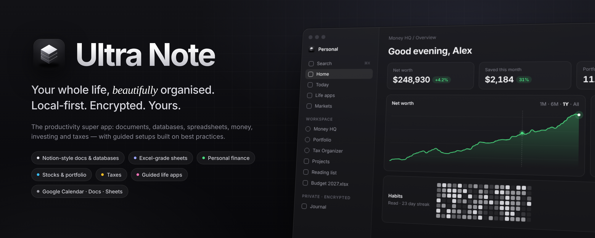
</p>

<p align="center">
  <a href="https://github.com/devartin/emp/releases/latest"></a>
  <a href="https://github.com/devartin/emp/actions/workflows/ci.yml"></a>
  
  
  <a href="LICENSE"></a>
</p>

<p align="center">
  <b>Ultra Note</b> is a productivity super app for your whole life — documents, databases, spreadsheets, money, investing and taxes —
  that runs entirely on your computer, encrypts what you write, and sets itself up for you with best practices built in.
</p>

<p align="center">
  <a href="https://github.com/devartin/emp/releases/latest"><b>Download</b></a> ·
  <a href="#features">Features</a> ·
  <a href="#security">Security</a> ·
  <a href="#build-from-source">Build from source</a> ·
  <a href="docs/SPEC.md">Spec</a>
</p>

---

<p align="center">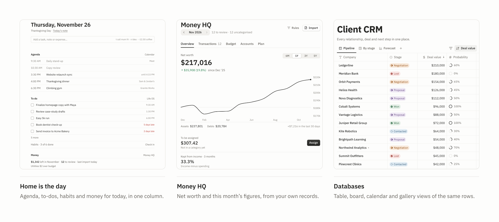</p>

## See it move

<table>
  <tr>
    <td width="50%"><br><sub><b>Unlock → Home.</b> The vault opens and your day assembles itself.</sub></td>
    <td width="50%">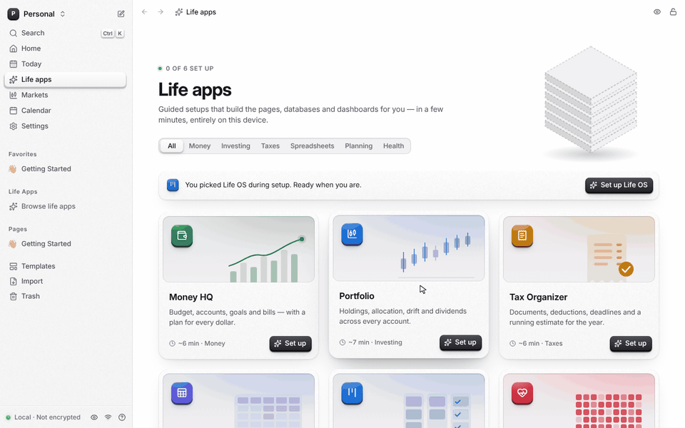<br><sub><b>Life apps build your workspace.</b> Answer three questions; Ultra Note lays down every page, database and reminder.</sub></td>
  </tr>
  <tr>
    <td width="50%">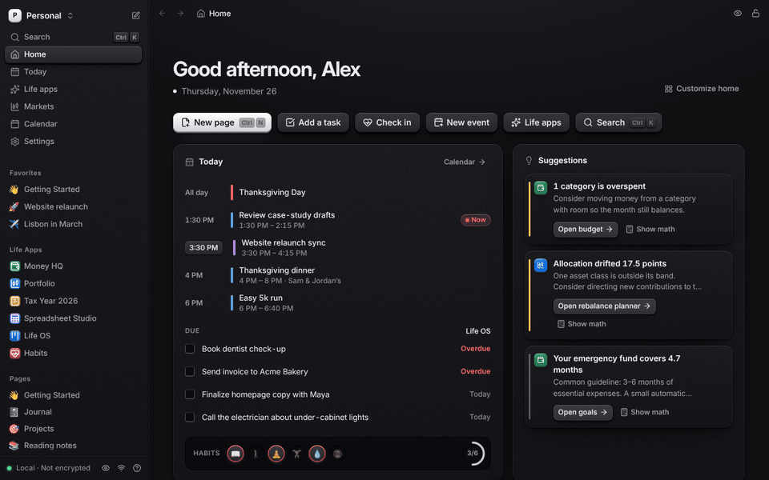<br><sub><b>Money HQ.</b> Numbers count up, and scrubbing the chart rolls every figure to that day.</sub></td>
    <td width="50%"><br><sub><b>Command palette.</b> <kbd>⌘K</kbd> / <kbd>Ctrl K</kbd> to search, run commands and jump anywhere.</sub></td>
  </tr>
</table>

## Why Ultra Note

Notion is wonderful until you want it offline, private, fast — or until you need a real spreadsheet, a budget that
understands money, or a portfolio that knows what XIRR is. Ultra Note keeps everything you love about a block-based workspace and
adds the parts of life that usually live in five other apps.

- **Local-first.** Your workspace is a file on your disk. No account, no server, no telemetry. It works on a plane.
- **Encrypted if you want it.** Turn on vault encryption and every record is sealed with modern, authenticated cryptography.
- **Set up for you.** Pick a *life app* — budgeting, investing, taxes, habits — answer a few questions and Ultra Note builds the whole
  system: pages, databases, dashboards, formulas and the written guidance explaining *why*.
- **Fast and polished.** A native Rust core, a 60 fps interface, and micro-interactions that make it a pleasure to use.

## Features

### ✍️ Docs & databases — Notion-class
- Block editor: headings, toggles, to-dos, callouts, quotes, code (syntax highlighting), equations (KaTeX), tables, columns,
  images, files, table of contents, page links, @-mentions, backlinks, emoji.
- Slash menu, drag-and-drop blocks with nesting, *turn into*, markdown shortcuts, find & replace, page history with restore.
- Databases with 25 property types (relations, rollups, formulas, money, ratings, progress, tickers, recurrence…), and
  **table, board, list, gallery, calendar and chart** views with nested filters, multi-sort, grouping and footer calculations.
- Daily notes, favourites, trash, templates, command palette (<kbd>⌘K</kbd>) and quick find (<kbd>⌘P</kbd>).

### 📊 Sheets — Excel-grade
- Canvas-rendered grid that stays smooth with hundreds of thousands of cells.
- A formula engine written in Rust with hundreds of Excel functions, **dynamic arrays and spill**, `XLOOKUP`, `FILTER`,
  `SORT`, `UNIQUE`, `PMT`, `XIRR`… plus `STOCK()` and `FX()` for live market data.
- Import **.xlsx / .xls / .ods / .csv**, export **.xlsx / .csv**. Freeze panes, merges, number and conditional formats.

### 💸 Money HQ — personal finance done right
- Import bank statements (**CSV, OFX, QFX, QIF**) with automatic column detection, de-duplication, transfer matching and
  categorisation rules. No bank login required.
- Budgets (50/30/20, zero-based, envelopes), recurring bills and subscription detection, net worth, savings goals.
- Debt payoff planner comparing **avalanche vs snowball**, and a cash-flow forecast with uncertainty bands.
- Gorgeous charts: net-worth timeline with scrubbing, cash-flow Sankey, budget rings, spending donut.

### 📈 Portfolio & markets
- Holdings with tax lots, realised/unrealised gains, **XIRR and time-weighted returns**, dividends, allocation vs target,
  drift and a **rebalancing planner** that proposes trades.
- Watchlists and candlestick charts with SMA 20/50/200 and volume.
- Market data from keyless public sources (FX, end-of-day prices, crypto), or bring your own API key.

### 🧾 Taxes
- Tax Organizer with a document checklist, deductions tracker, deadlines and retention guidance.
- A US federal estimator and quarterly estimated-payment planner — clearly labelled as **estimates**, not tax advice.

### 🧭 Guided life apps
| App | What it sets up for you |
|---|---|
| **Money HQ** | Accounts, budget method of your choice, emergency fund, debt plan, subscriptions, net-worth dashboard |
| **Portfolio** | Investment policy, target allocation, holdings & lots, watchlist, rebalancing bands |
| **Tax Organizer** | Document checklist, deductions log, estimated payments calendar |
| **Spreadsheet Studio** | Ready-made workbooks: budgets, loan & mortgage models, trackers |
| **Life OS** | Goals → projects → tasks, today view, weekly review |
| **Habits** | Habit tracker with streaks, heatmaps and gentle check-ins |

Each app keeps watching your data and surfaces **insights** — *"You're 2 months from a full emergency fund"*,
*"Your bond allocation drifted 6 % past its band"*.

### 🔗 Connections — always optional
- **Google Calendar** (read & sync), **Google Docs** and **Google Sheets** (import/export) using your own Google Cloud
  OAuth client — Ultra Note ships no secrets.
- **.ics** calendars, **Markdown** and **Notion export** import, **Excel** in and out, export everything to Markdown/CSV/JSON.
- A built-in **network log** and an **offline switch**: you can see every request Ultra Note makes, and stop them all.

## Screenshots

| | |
|---|---|
| 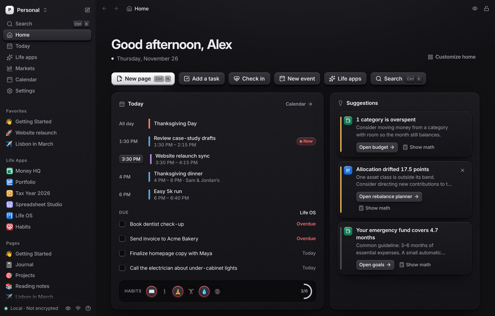 **Home** — your day at a glance | 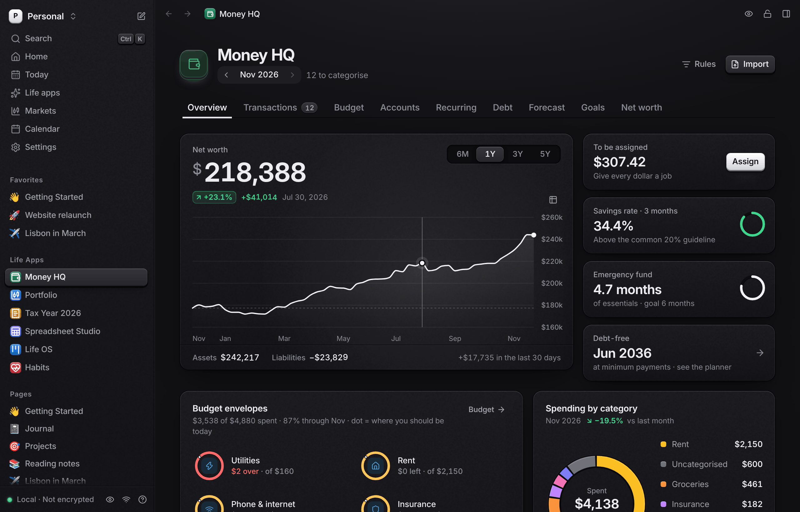 **Money HQ** — net worth, envelopes and spending |
| 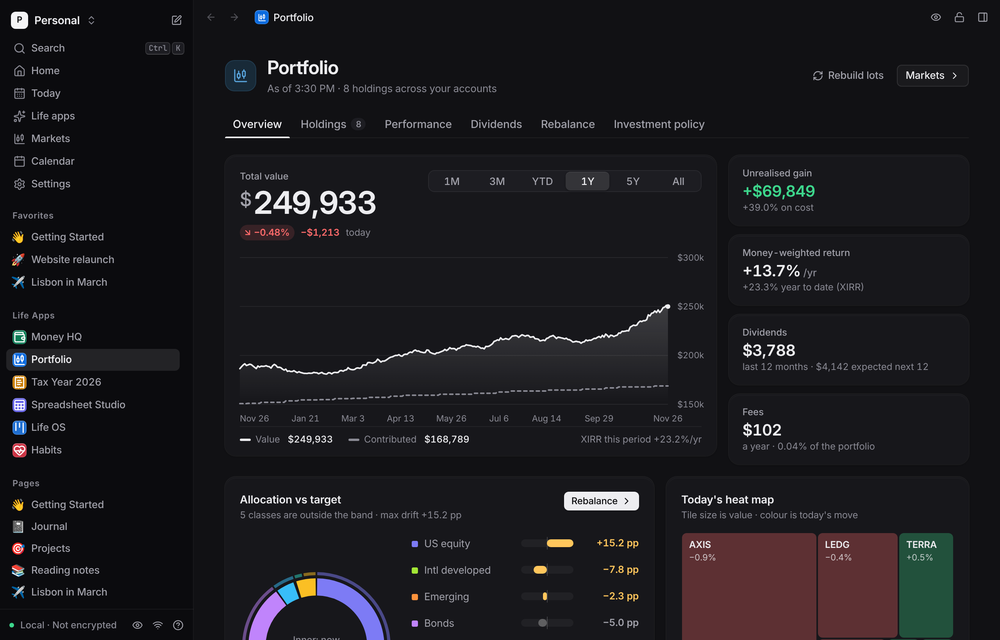 **Portfolio** — value, drift and today's heat map | 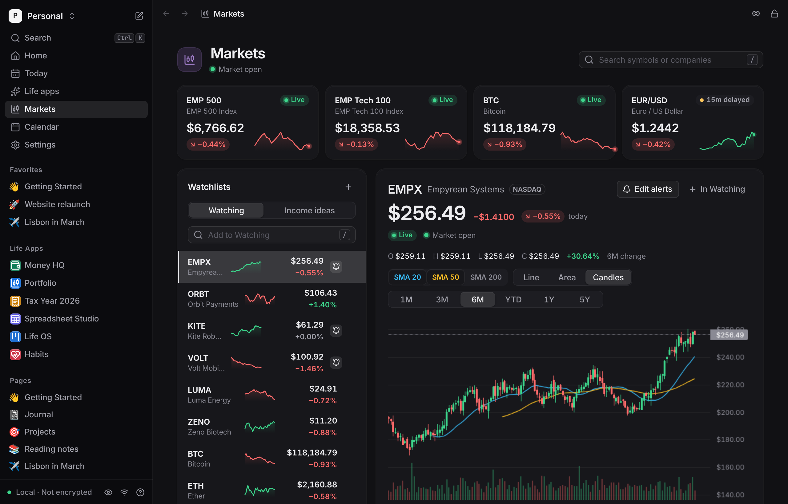 **Markets** — watchlists and candles with moving averages |
|  **Databases** — a CRM as a board, grouped by stage | 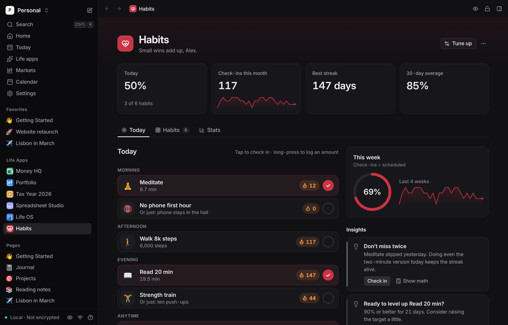 **Habits** — check-ins, streaks and gentle insights |
| 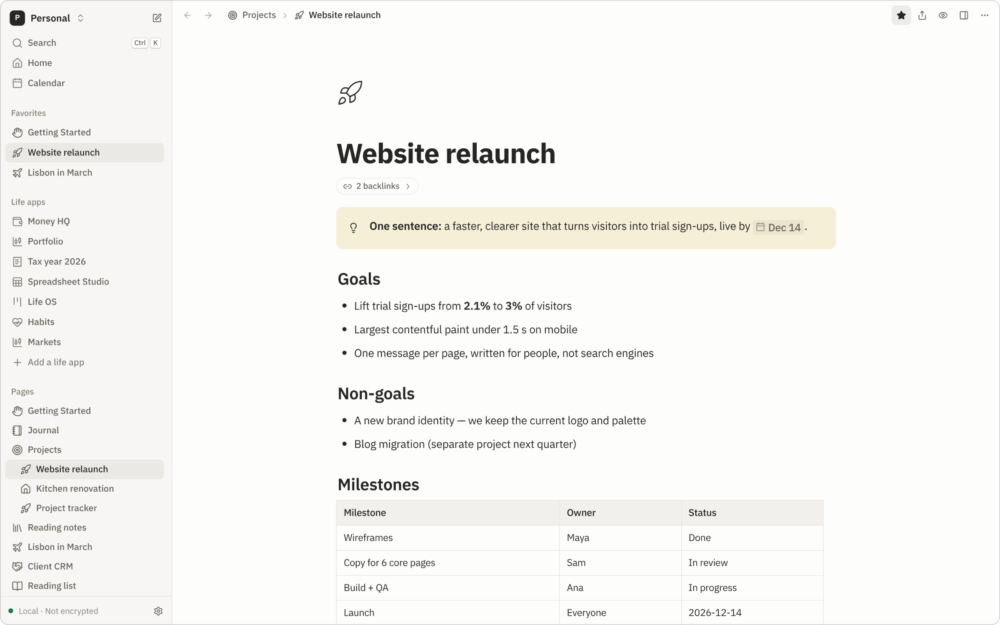 **Pages** — a block editor with covers, callouts and backlinks | 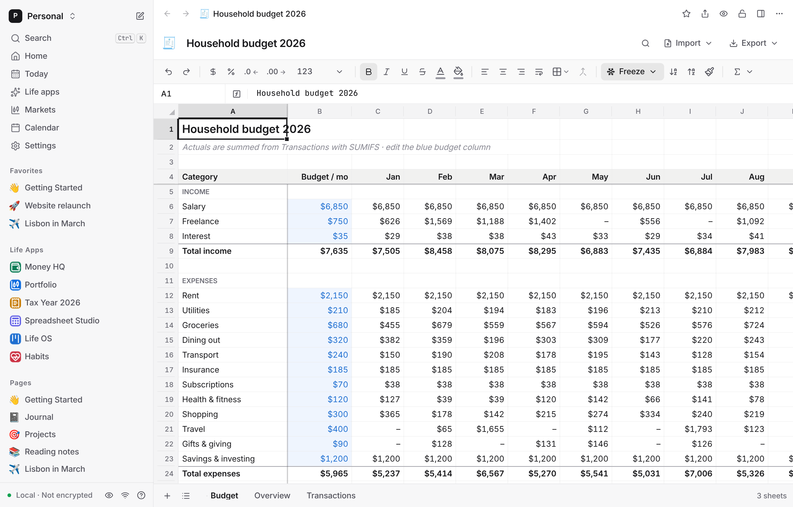 **Sheets** — a real formula engine behind every cell |
| 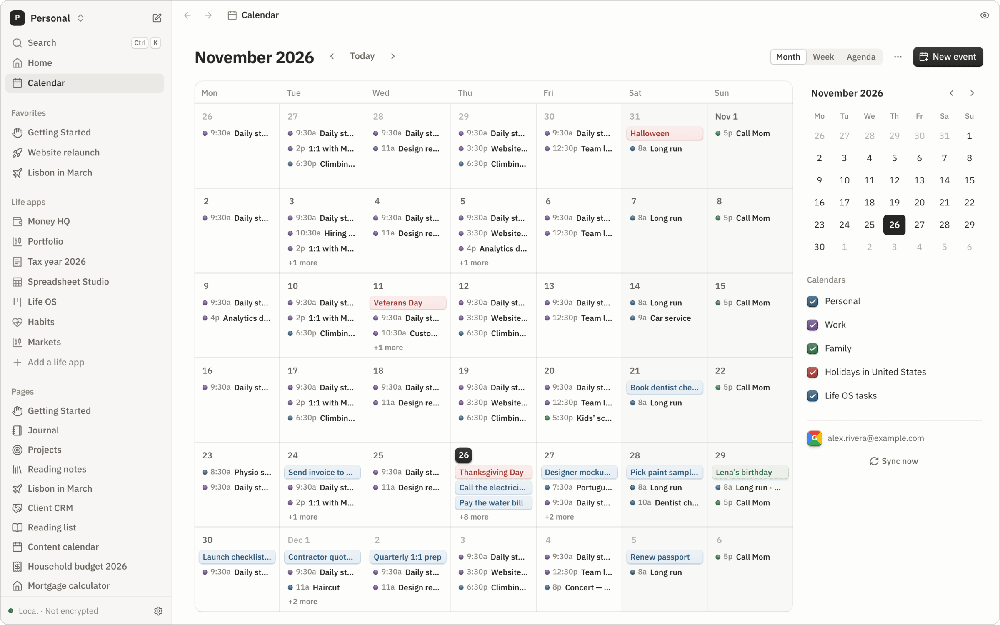 **Calendar** — every calendar in one month view | 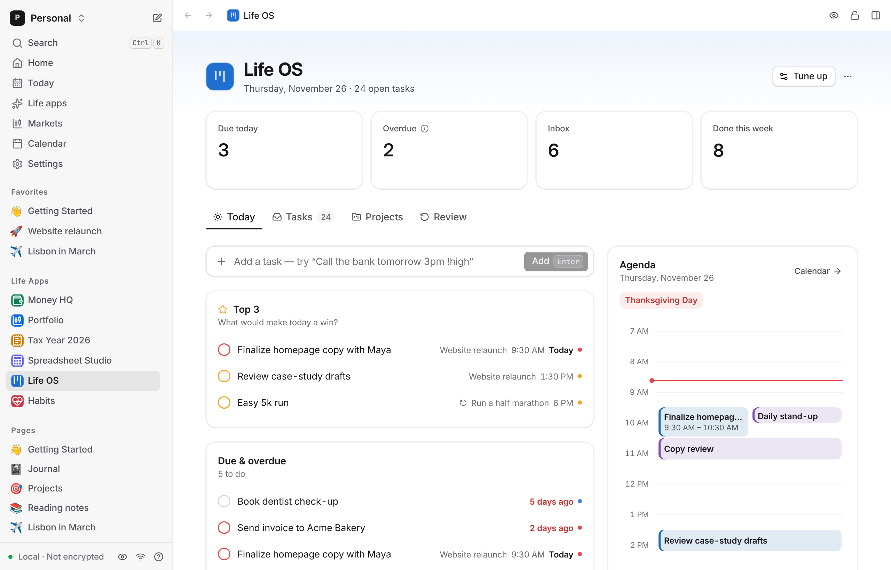 **Life OS** — Top 3, tasks and the day's agenda |
| 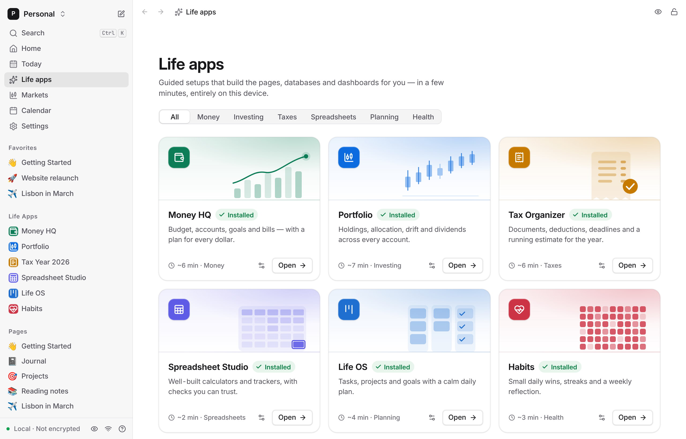 **Life apps** — guided setups that build the system for you | 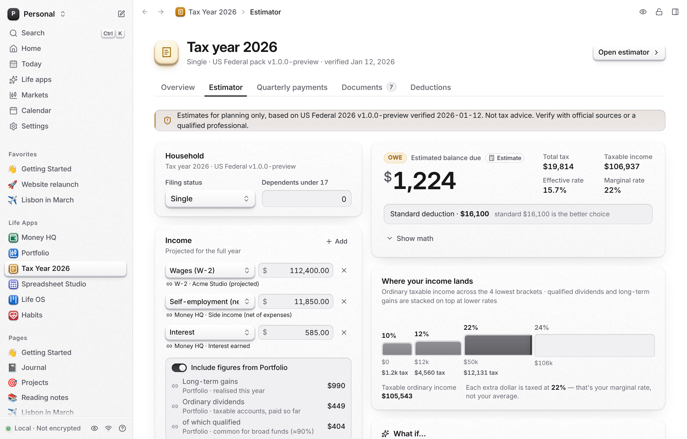 **Taxes** — a clearly-labelled federal estimator |

## Security

Ultra Note is designed so that a stolen laptop reveals as little as possible.

| | |
|---|---|
| **Key derivation** | Argon2id, calibrated per device (default 256 MiB, 3 passes) |
| **Encryption** | XChaCha20-Poly1305 for every record, with the record's identity bound as associated data |
| **Keys** | Random 256-bit data key wrapped by your password *and* a 24-word recovery key; keys are zeroised on lock |
| **Integrity** | Authenticated encryption plus an integrity manifest that detects deleted or rolled-back records |
| **Auto-lock** | On idle, sleep and screen lock; brute-force throttling on unlock |
| **App hardening** | Strict Content-Security-Policy, minimal Tauri capabilities, no shell access, every network call through one guarded client |
| **Secrets** | API keys and OAuth tokens are always encrypted, even when vault encryption is off |

We deliberately don't use the phrase "military-grade". Ultra Note uses standard, well-reviewed primitives, and we document
exactly what is and isn't protected — including the small amount of structural metadata that stays visible on disk. See
[SECURITY.md](SECURITY.md) and [SPEC §9](docs/SPEC.md#9-security-spec).

## Download

Grab the latest installer for your platform from **[Releases](https://github.com/devartin/emp/releases/latest)**:

| Platform | Files |
|---|---|
| macOS 12+ (Apple Silicon & Intel) | `.dmg` |
| Windows 10/11 (x64) | `.msi` or `-setup.exe` |
| Linux (x64) | `.AppImage`, `.deb`, `.rpm` |

> **First launch on macOS / Windows:** early builds are not yet code-signed. On macOS, right-click the app → **Open**
> (or *System Settings → Privacy & Security → Open Anyway*). On Windows, click **More info → Run anyway** in SmartScreen.

## Build from source

Requirements: Rust (stable), Node.js 22+, and the [Tauri prerequisites](https://tauri.app/start/prerequisites/) for your OS.

```bash
git clone https://github.com/devartin/emp && cd emp
npm ci
npm run tauri dev        # run the desktop app with hot reload
npm run tauri build      # produce installers in target/release/bundle
```

Try the interface in a browser with an in-memory demo backend (no Rust needed):

```bash
npm run dev:mock         # then open http://localhost:1420/?seed=demo
```

Tests:

```bash
cargo test --workspace
npm test
```

## Architecture

```
┌───────────────────── Ultra Note desktop app (Tauri 2) ─────────────────────┐
│  React 19 · TypeScript · Tailwind · motion · TipTap · Recharts             │
│  ── typed IPC (231 commands, strict allowlist) ──                          │
│  emp-app      commands, auto-lock, jobs, asset protocol, OS keychain       │
│  emp-store    SQLite, vault, encrypted records, search, life apps, import  │
│  emp-crypto   Argon2id, XChaCha20-Poly1305, keyslots, recovery key         │
│  emp-sheets   formula engine, dependency graph, xlsx/csv                   │
│  emp-finance  statements, budgets, debt, forecast, portfolio, tax          │
│  emp-integrations  NetGuard, Google OAuth (PKCE), market data, ICS         │
└────────────────────────────────────────────────────────────────────────────┘
```

Ultra Note was called EMP during early development. The codename survives in internal identifiers (the `emp-*`
crates, file extensions such as `.empbackup`, storage keys); only the product name changed.

The full design — every token, animation curve, schema table and IPC command — lives in [docs/SPEC.md](docs/SPEC.md),
and the brainstorm that produced it in [docs/BRAINSTORM.md](docs/BRAINSTORM.md).

## License

[MIT](LICENSE) © devartin
