<p align="center">
  <picture>
    <source media="(prefers-color-scheme: dark)" srcset="docs/assets/banner-dark.png">
    
  </picture>
</p>

<p align="center">
  <a href="https://github.com/devartin/ultra-note/releases/latest"></a>
  <a href="https://github.com/devartin/ultra-note/actions/workflows/ci.yml"></a>
  
  
  <a href="LICENSE"></a>
</p>

<p align="center">
  <b>Ultra Note</b> is a desktop app for pages, databases, spreadsheets and personal finance.<br>
  Everything lives in a folder on your computer. Encryption is optional and no account is needed.
</p>

<p align="center">
  <a href="https://github.com/devartin/ultra-note/releases/latest"><b>Download</b></a> ·
  <a href="#features">Features</a> ·
  <a href="#security">Security</a> ·
  <a href="#build-from-source">Build from source</a> ·
  <a href="docs/DESIGN.md">Design</a> ·
  <a href="docs/SPEC.md">Spec</a>
</p>

---

<p align="center">
  <picture>
    <source media="(prefers-color-scheme: dark)" srcset="docs/assets/features-dark.png">
    
  </picture>
</p>

## See it move

Each clip is a GIF; click it for the full-quality MP4.

<table>
  <tr>
    <td width="50%" valign="top">
      <a href="docs/media/unlock.mp4">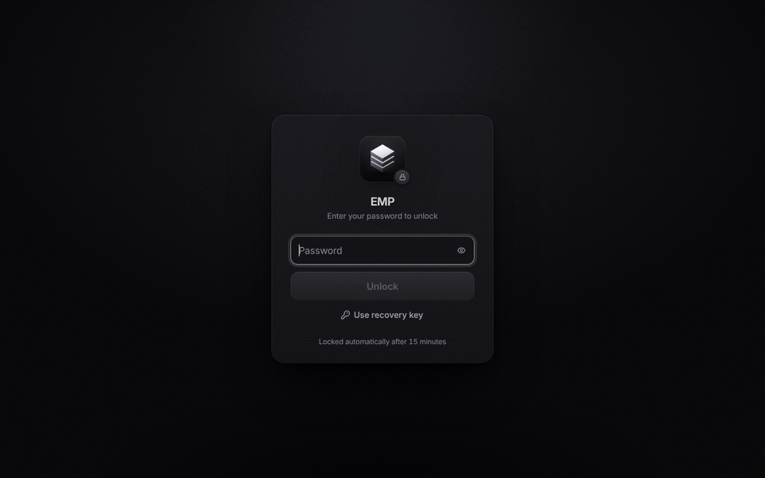</a><br>
      <sub><b>Unlock.</b> Type the password and the vault opens straight onto Home. This is one of only three moments in the app with a deliberate animation.</sub>
    </td>
    <td width="50%" valign="top">
      <a href="docs/media/life-app-build.mp4">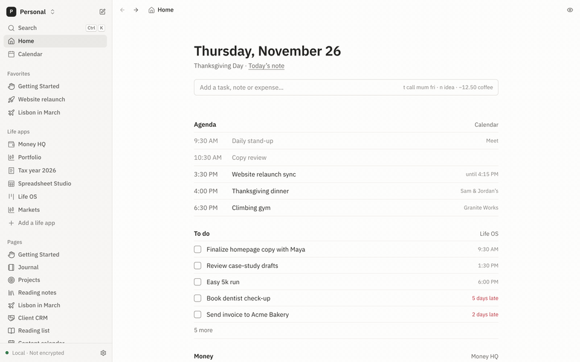</a><br>
      <sub><b>Set up a life app.</b> Pick your habits, review what will be created, then Habits builds its pages, databases and reminders. The progress bar follows the real work.</sub>
    </td>
  </tr>
  <tr>
    <td width="50%" valign="top">
      <a href="docs/media/capture.mp4">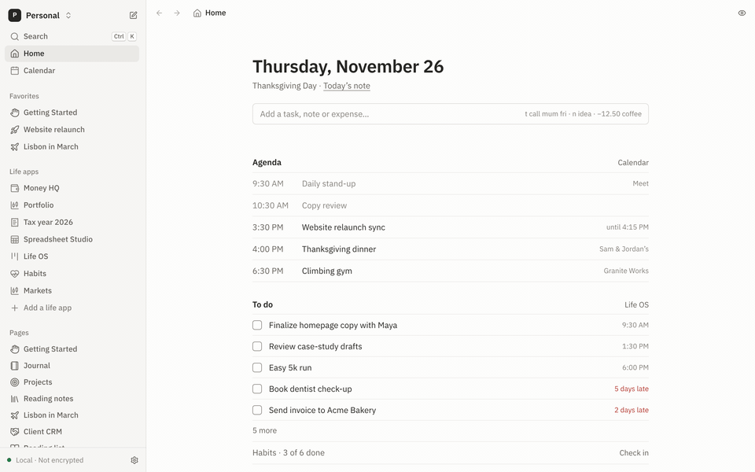</a><br>
      <sub><b>Capture from Home.</b> <code>t call mum fri</code> becomes a Life OS task due Friday; <code>-12.50 coffee</code> becomes an expense in Money HQ. Each toast offers View and Undo.</sub>
    </td>
    <td width="50%" valign="top">
      <a href="docs/media/command-palette.mp4">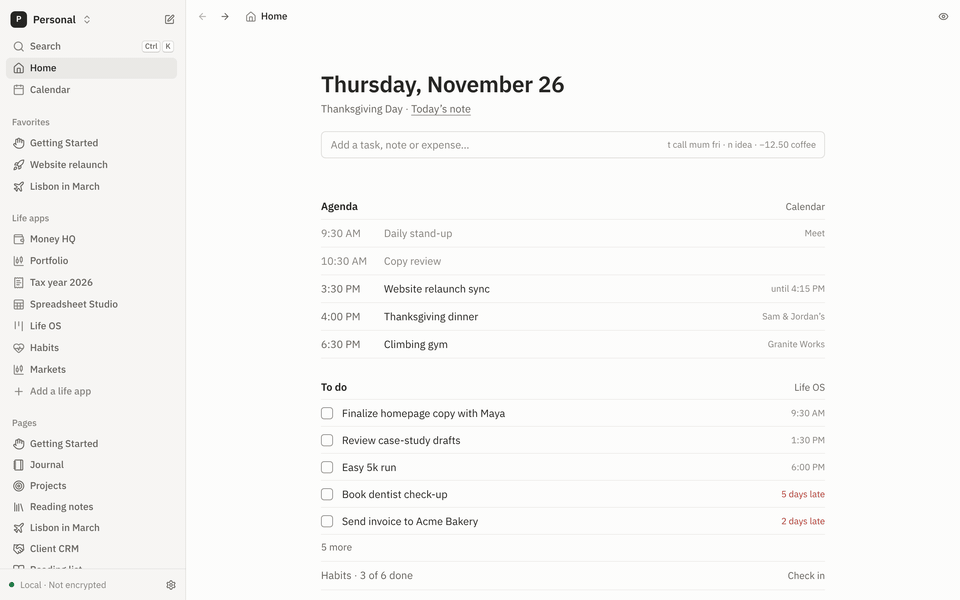</a><br>
      <sub><b>Command palette.</b> <kbd>Ctrl K</kbd> (<kbd>⌘K</kbd> on macOS) opens instantly. Type a few letters and press Enter to open any page, app tab or command.</sub>
    </td>
  </tr>
  <tr>
    <td width="50%" valign="top">
      <a href="docs/media/money.mp4">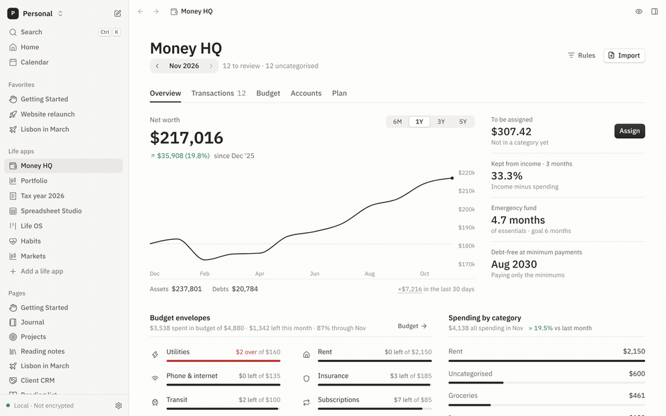</a><br>
      <sub><b>Money HQ.</b> Scrubbing the net-worth chart rewrites the figure above it. Transactions opens on the To review lane; marking a row reviewed takes it out of the count.</sub>
    </td>
    <td width="50%" valign="top">
      <a href="docs/media/database.mp4">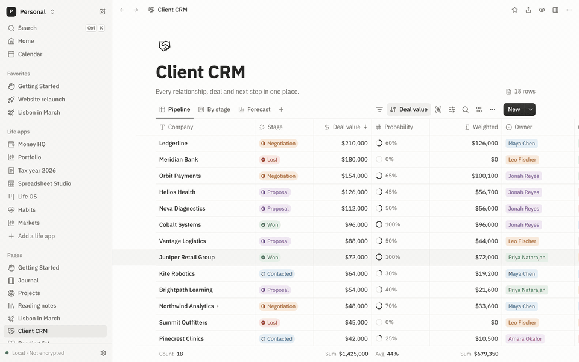</a><br>
      <sub><b>Databases.</b> The same rows as a table, then as a board grouped by stage. A card opens in a side peek, so the board stays in view.</sub>
    </td>
  </tr>
</table>

## Why Ultra Note

Block-based workspaces are good at pages and tables. They are less good offline, they keep your data on someone
else's server, and they stop short of a real spreadsheet or a budget that understands money. Ultra Note keeps the
workspace and adds the parts that usually live in other apps.

- **Local-first.** The workspace is a SQLite database and an assets folder on your disk. No account, no server, no
  telemetry. It works offline.
- **Encrypted if you want it.** Turn on vault encryption and every record is sealed with authenticated encryption
  under a key only your password and recovery key can open.
- **Set up for you.** A *life app* (budgeting, investing, taxes, tasks, habits) asks a few questions, then builds the
  pages, databases, formulas and reminders, with a written guide to why each part is there.
- **Fast and plain.** The core is native Rust. Numbers are set like a bank statement, and things move only when
  something happened.

## Features

### Home and capture
- **Home is the day.** The date, one capture field, today's agenda, what is due (Life OS tasks plus the unchecked
  to-dos in today's note), one line of habits, one line of money, and recent pages. Empty sections are left out, and
  the layout does not change from day to day.
- **The money line** reads like *"$1,342 left in November · 12 to review · last import today"*. Each part links to
  the place that explains it. Net worth is never on Home.
- **Capture by prefix**, in the Home field or in <kbd>⌘K</kbd>: `t` or `task` adds a task (with dates such as "fri",
  `!high` and `#tags`), `n` or `note` appends to today's note, and `-12.50 coffee` or `spent 12.50 coffee` records an
  expense (`+250 refund` records income). Text without a prefix is never guessed at; if an amount can't be read, the
  row says so.
- <kbd>j</kbd> / <kbd>k</kbd> move through Home's rows from the moment it opens, <kbd>x</kbd> ticks a to-do and
  <kbd>Enter</kbd> opens it.

### Pages and databases
- Block editor: headings, toggles, to-dos, callouts, quotes, code with syntax highlighting, equations (KaTeX),
  tables, columns, images, files, a table of contents, page links, @-mentions, backlinks and embedded databases,
  sheets, charts and watchlists.
- Slash menu, drag-and-drop blocks with nesting, *turn into*, Markdown shortcuts, find and replace, and page history
  with restore.
- Databases with 25 property types (relations, rollups, formulas, money, ratings, progress, tickers, recurrence and
  more) and **table, board, list, gallery, calendar and chart** views, with nested filters, multi-sort, grouping,
  footer calculations and a side peek for rows.
- Daily notes in a Journal, a Favorites section, templates and trash.
- Page icons come from one set of about 120 monochrome line glyphs in 8 searchable groups. Emoji icons in older
  workspaces and imports are mapped to the nearest glyph; text you type in your own pages is left as you wrote it.

### Sheets
- A canvas-drawn grid that stays smooth with hundreds of thousands of cells.
- A formula engine written in Rust with about 240 functions, including **dynamic arrays and spill**, `XLOOKUP`,
  `FILTER`, `SORT`, `UNIQUE`, `LET`, `PMT` and `XIRR`, plus `STOCK()` and `FX()` for market data.
- Import **.xlsx** and **.csv**, export **.xlsx** and **.csv**. Frozen panes, merged cells, number formats and
  conditional formats.

### Money HQ
- Five tabs: **Overview, Transactions, Budget, Accounts** (net worth inside) and **Plan** (recurring bills, debt,
  forecast, goals). It always opens on Overview, and <kbd>⌘1</kbd> to <kbd>⌘9</kbd> switch tabs in any life app.
- **One import** for bank files: **OFX, QFX, QIF and CSV**, with column detection, saved profiles, duplicate
  detection, transfer matching and categorisation rules. No bank login. Bank files dropped on the general Import
  dialog go to the same place.
- **To review.** Imported rows arrive unreviewed. Transactions opens on a To review lane while it has rows; select
  some and *Mark reviewed*. Home and Money HQ show the same count.
- **Reconcile** an account against its statement. You enter the balance (or accept the one your OFX file reported,
  with its date), tick cleared rows and see the difference live. Finishing locks the reconciled rows.
- Budgets in the method you choose (50/30/20, zero-based, envelopes, pay yourself first, or tracking only),
  recurring bills and subscription detection, savings goals, and an emergency-fund figure in months.
- A debt planner comparing **avalanche, snowball and hybrid**, and a cash-flow forecast with uncertainty bands.
- Charts drawn in ink: a net-worth line you can scrub (the headline figure follows), a cash-flow Sankey, and spending
  by category as sorted bars.
- Every headline figure has one label and one definition. Click it to see the inputs behind it.
- <kbd>⌘⇧H</kbd> hides every amount when someone is looking over your shoulder.

### Portfolio and markets
- Holdings with tax lots (first-in, first-out), realised and unrealised gains, **money-weighted (XIRR) and
  time-weighted returns** against a benchmark, dividends and fees.
- Allocation against target with drift bands, and a **rebalancing planner** that proposes trades.
- An investment policy page that records your targets and rules.
- Markets: watchlists and a price chart in line, area or candles, with SMA 20, 50 and 200 and volume.
- Market data from keyless public sources (FX, end-of-day prices, crypto), or your own API key for providers that
  need one.

### Taxes
- Tax Organizer with a document checklist, a deductions log, deadlines and record-retention guidance.
- A US federal estimator and quarterly estimated-payment planner, clearly labelled as **estimates, not tax advice**.
  The 2026 tax pack covers the SALT cap, the 7.5% medical floor, the non-itemiser cash charity deduction and the 0.5%
  charitable floor for itemisers.
- The tax pack lists the IRS and SSA sources behind every figure and the date they were checked, and each estimate
  names the pack version it used.

### Life apps

Each life app asks a few questions (Quick) or all of them (Guided), shows what it will create, then builds it.

| App | What it sets up |
|---|---|
| **Money HQ** | Accounts, a budget in your chosen method, bills, debt plan, emergency fund, savings goals and net-worth history |
| **Portfolio** | Investment policy, target allocation and rebalancing bands, accounts, holdings and lots, dividends, watchlist and benchmark |
| **Tax Organizer** | Filing details, income kinds, document checklist, deductions log, estimated payments and deadline reminders |
| **Spreadsheet Studio** | Ready-made workbooks: loan, budget, decision matrix, project plan, timesheet, inventory, bill split and compound growth |
| **Life OS** | Tasks (Inbox, Next, Scheduled, Waiting, Someday), projects, areas, a daily plan and a weekly review |
| **Habits** | Habits with a streak rule you choose, a daily check-in, heatmaps, completion stats and a weekly reflection |

Installed apps keep checking your data and leave short notes in plain words, such as *"Savings rate is down 3 months
in a row"* or *"Not reconciled in the last 30 days"*. Each app has a written guide explaining its method.

### Search and keyboard
- <kbd>⌘</kbd> is <kbd>Ctrl</kbd> on Windows and Linux.
- <kbd>⌘K</kbd> searches pages, database rows, sheets and every life-app tab, and runs commands. Prefixes switch
  mode: `>` commands, `#` databases and rows, `@` dates, `$` quotes, `=` a calculator with unit and currency
  conversion, `?` shortcuts.
- <kbd>⌘P</kbd> quick find, <kbd>⌘N</kbd> new page, <kbd>⌘⌥D</kbd> today's note, <kbd>⌘⇧L</kbd> lock now, <kbd>⌘,</kbd>
  settings. The full list is in Settings, Keyboard shortcuts.
- The sidebar's primary rows (Search, Home, Calendar) can be hidden or reordered. Life apps lists what you have
  installed, plus Markets once you track investments.

### Import, export and connections
- One **Import** dialog that detects the file: Markdown files and folders (including Obsidian vaults), Notion export
  zips, .ics calendars, CSV (as a new database), Excel workbooks and bank files. Finished imports can be undone.
- **Export** pages as Markdown or JSON, or export everything to a folder of Markdown, CSV and XLSX.
- **Google Calendar** sync, and **Google Docs** and **Google Sheets** import and export, using your own Google Cloud
  OAuth client. Ultra Note ships no secrets.
- A built-in **network log** and an **offline switch** (<kbd>⌘⇧O</kbd>): you can see every request Ultra Note makes,
  and stop them all.

## Screenshots

| | |
|---|---|
| 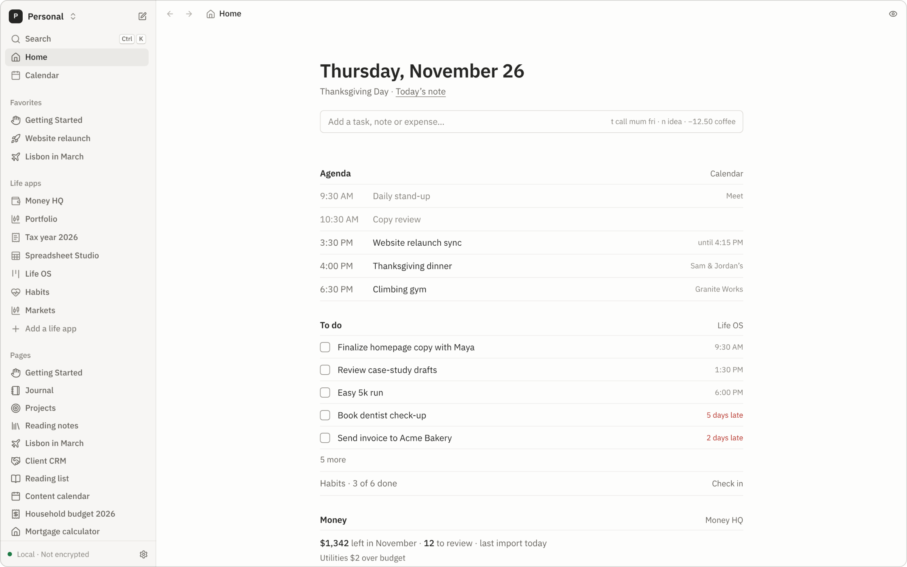 **Home.** The day in one column |  **Money HQ.** Net worth, envelopes and spending |
| 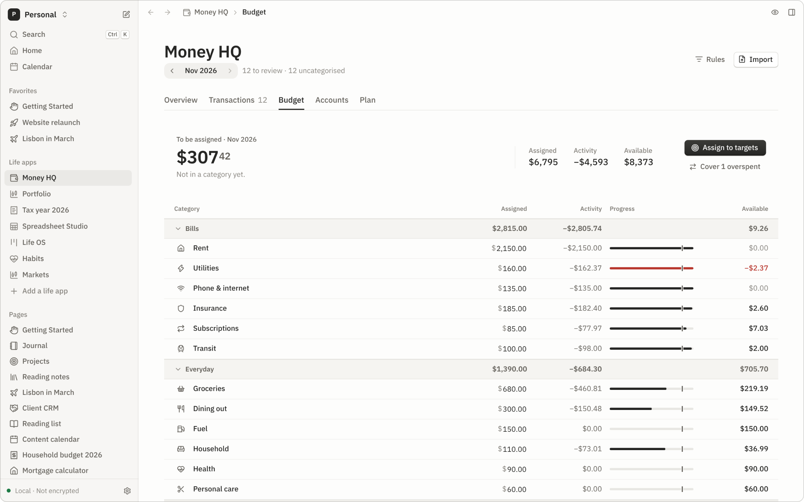 **Budget.** Assigned, spent and available for every category |  **Portfolio.** Value, returns, drift and today's moves |
| 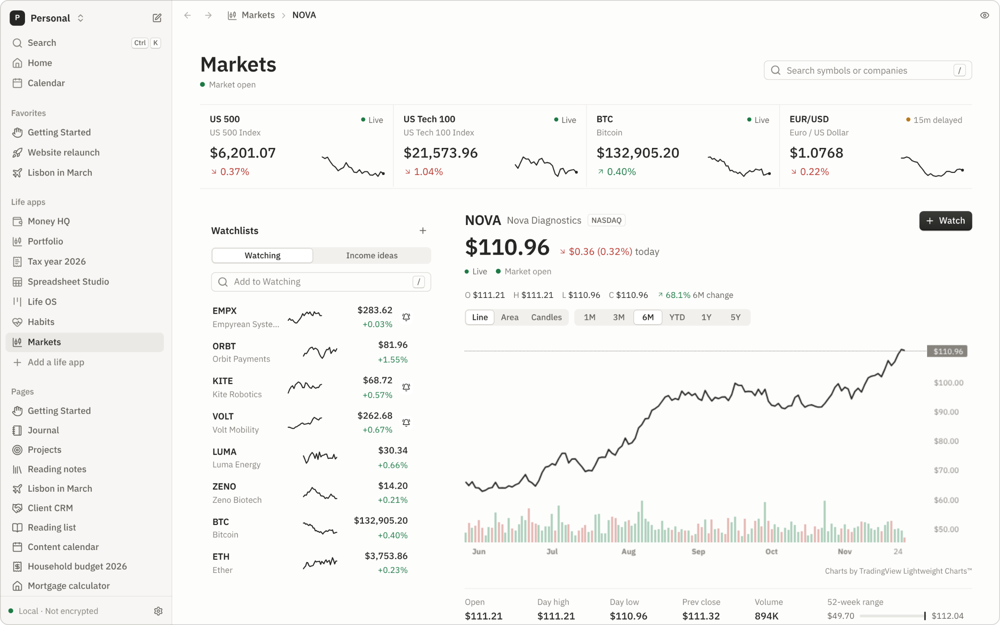 **Markets.** Watchlists and price charts | 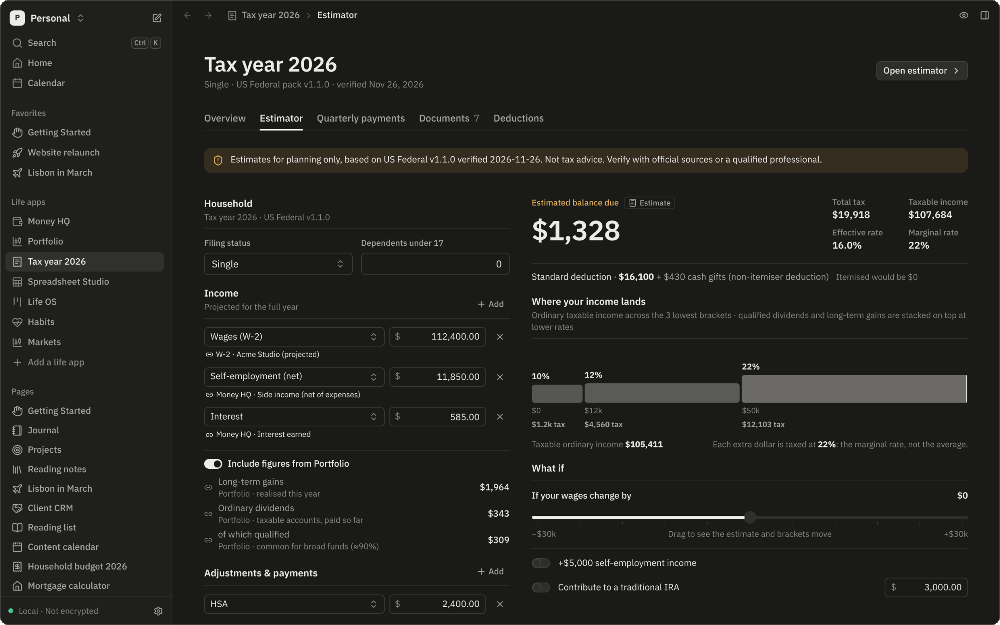 **Taxes.** A labelled federal estimator |
| 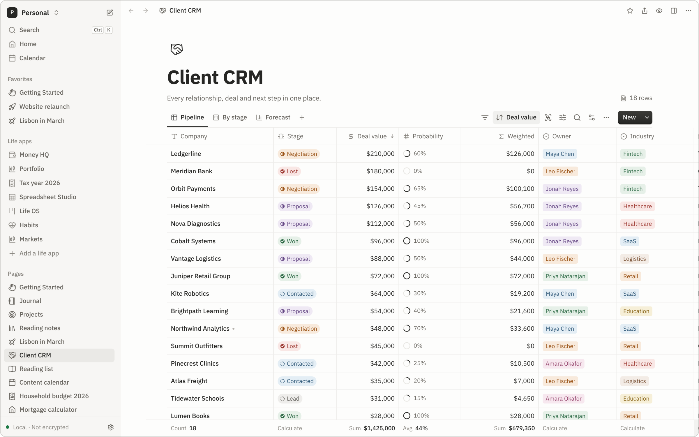 **Databases.** A CRM as a table with footer sums | 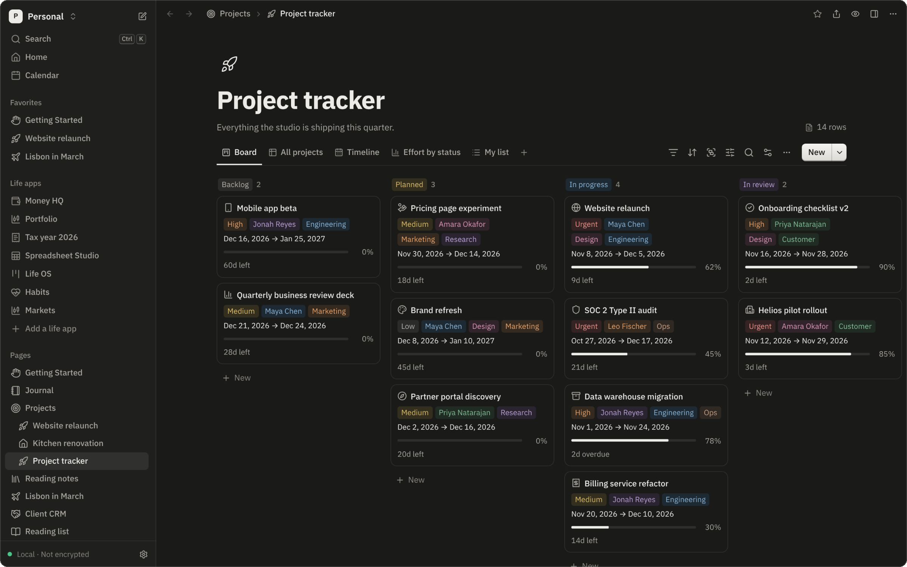 **Boards.** The same kind of rows, grouped by status |
|  **Pages.** A block editor with callouts, tables and backlinks | 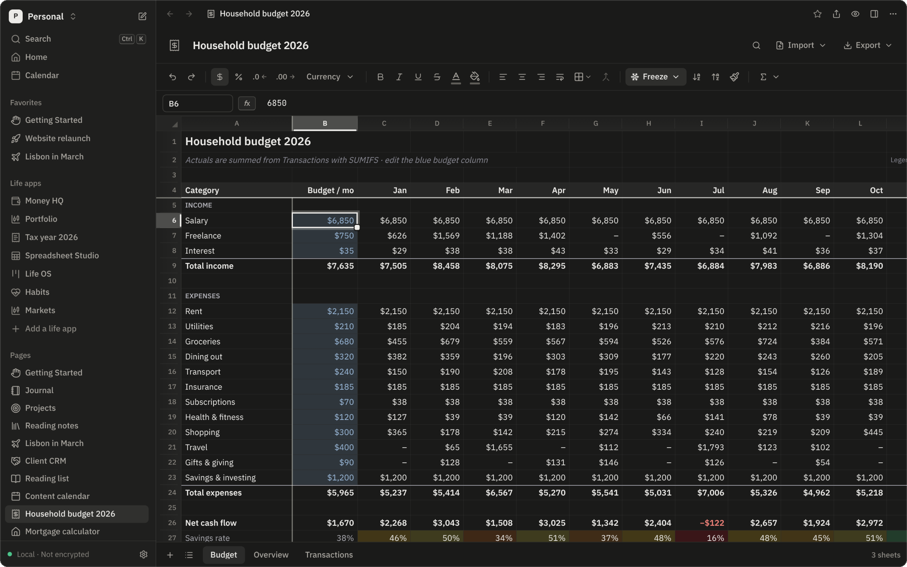 **Sheets.** About 240 functions, with dynamic arrays |
|  **Calendar.** Every calendar in one month view | 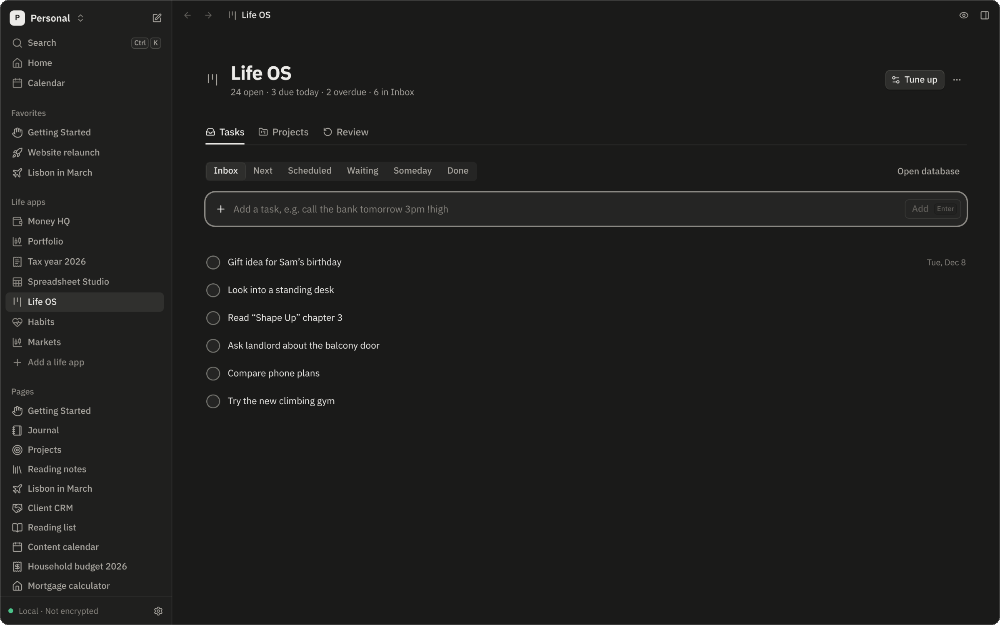 **Life OS.** Tasks, projects and a weekly review |
| 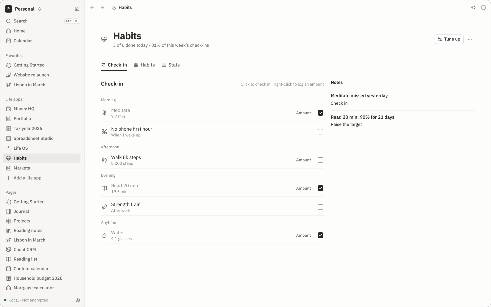 **Habits.** A daily check-in, with heatmaps and stats a tab away | 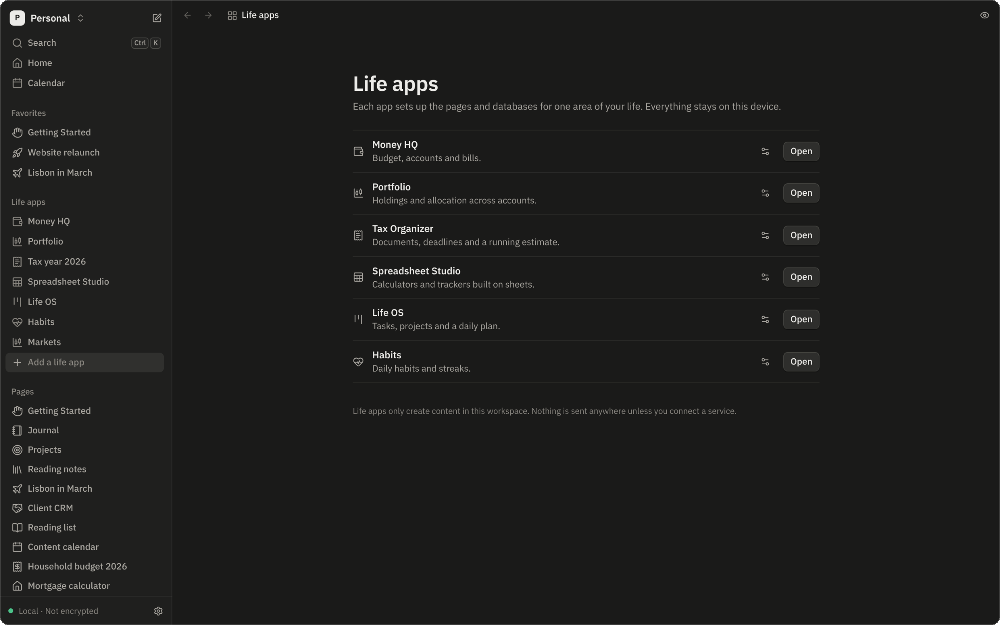 **Life apps.** Each one sets up the pages and databases for one area of your life |
| 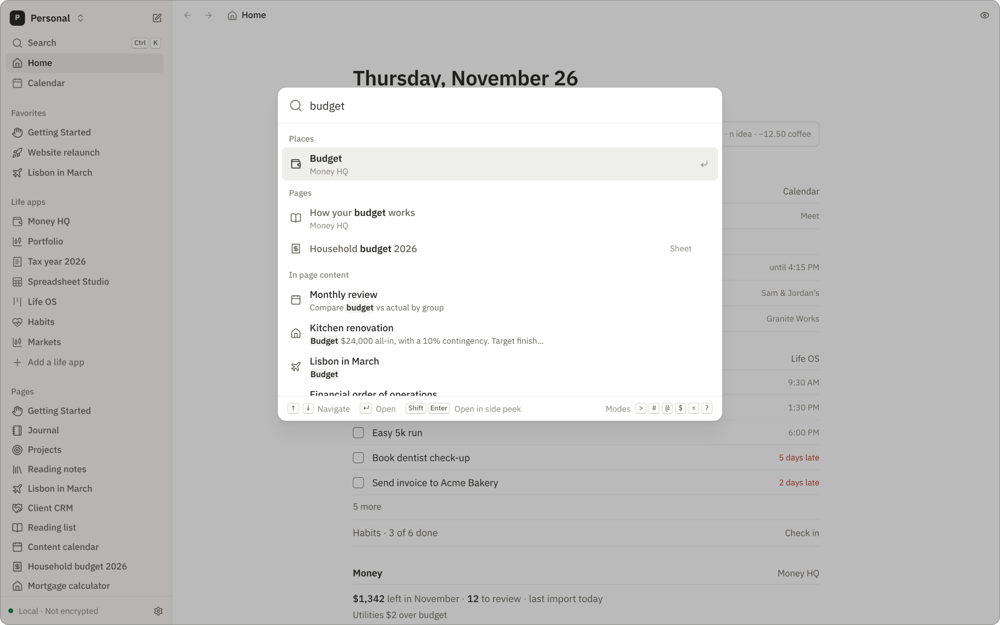 **Command palette.** Places, pages and page content in one list | 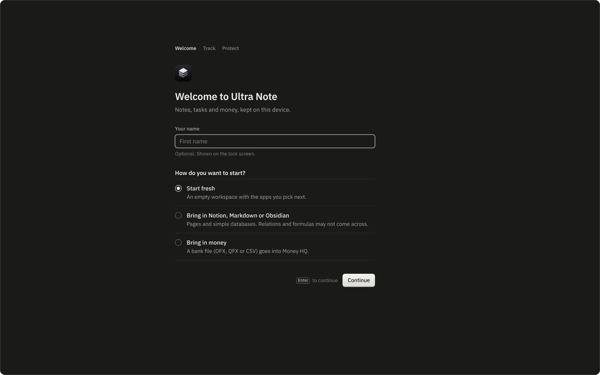 **First run.** Three short steps, then Home |

## Design

Ultra Note's visual language is called *paper, ink and keys*. The full rules are in [docs/DESIGN.md](docs/DESIGN.md).

- **Paper and ink.** A warm paper background and graphite ink as the only accent. Colour appears only where it
  carries meaning: gains and losses, over-budget amounts, and your own tags and chart categories.
- **Keys.** Only things you press have depth: one primary key per view, small keycaps for shortcuts, and the thumbs
  of switches. Everything else is flat, ruled with hairlines rather than boxed.
- **Statement numerals.** IBM Plex Sans with tabular figures, a true minus sign, the currency symbol at full size and
  dimmed cents in ledgers. Numbers are final from the first frame; they never count up on arrival.
- **Earned motion.** Frequent actions (typing, switching tabs, opening the palette by keyboard) are instant. Dialogs
  and side peeks move briefly. Three moments get a deliberate animation: unlocking the vault, building a life app
  and finishing a reconcile.
- **One glyph language.** Every page, habit and category icon is a monochrome line glyph, and the interface uses
  no emoji.
- **Accessibility.** With reduced motion, nothing travels and the three moments become a short crossfade. Text
  meets 4.5:1 contrast (3:1 for hints and control edges) in light, dark and midnight themes, checked by a test.
  Higher-contrast, text-size, density and readable-font settings are in Settings, and the main flows work from the
  keyboard.

## Security

Ultra Note is designed so that a stolen laptop reveals as little as possible.

| | |
|---|---|
| **Key derivation** | Argon2id, calibrated per device (default 256 MiB, 3 passes) |
| **Encryption** | XChaCha20-Poly1305 for every record, with the record's identity bound as associated data |
| **Keys** | A random 256-bit data key wrapped by your password *and* a 24-word recovery key; keys are zeroised on lock |
| **Integrity** | Authenticated encryption plus an integrity manifest that detects deleted or rolled-back records |
| **Auto-lock** | After inactivity, on sleep and on screen lock; unlock attempts are throttled |
| **App hardening** | Strict Content-Security-Policy, minimal Tauri capabilities, no shell access, every network call through one guarded client |
| **Secrets** | API keys and OAuth tokens are always encrypted, even when vault encryption is off |

The primitives are standard and well reviewed. [SECURITY.md](SECURITY.md) and [SPEC §9](docs/SPEC.md#9-security-spec)
state exactly what is protected and what is not, including the small amount of structural metadata (record ids, the
shape of the page tree, timestamps) that stays visible on disk.

## Download

Get the latest installer for your platform from **[Releases](https://github.com/devartin/ultra-note/releases/latest)**:

| Platform | Files |
|---|---|
| macOS 12+ (Apple Silicon and Intel) | `.dmg` |
| Windows 10/11 (x64) | `.msi` or `-setup.exe` |
| Linux (x64) | `.AppImage`, `.deb`, `.rpm` |

> **First launch on macOS and Windows:** early builds are not yet code-signed. On macOS, right-click the app and
> choose **Open** (or use *System Settings, Privacy & Security, Open Anyway*). On Windows, click **More info**, then
> **Run anyway** in SmartScreen.

## Build from source

Requirements: [rustup](https://rustup.rs) (it installs the pinned Rust toolchain automatically), Node.js 22+, and the
[Tauri prerequisites](https://tauri.app/start/prerequisites/) for your OS. Contributions are welcome; see
[CONTRIBUTING.md](CONTRIBUTING.md).

```bash
git clone https://github.com/devartin/ultra-note && cd ultra-note
npm ci
npm run tauri dev        # run the desktop app with hot reload
npm run tauri build      # produce installers in target/release/bundle
```

Try the interface in a browser with an in-memory demo backend (no Rust needed):

```bash
npm run dev:mock         # then open http://localhost:1420/?seed=demo
```

The demo is deterministic: add `&freeze=2026-11-26T15:30:00Z` to pin the clock, use `?seed=empty` to see first run,
and add `&locked=1` to start at the lock screen (the demo password is `demo`).

Tests:

```bash
cargo test --workspace
npm test                 # unit tests plus the style, copy, emoji and contrast guards
```

**Regenerate the screenshots.** Every image and clip in this README is captured from the demo, so it can be rebuilt
after a UI change. You need Playwright with Chromium and ffmpeg on your machine.

```bash
npm run media:capture    # stills into docs/screenshots, GIF and MP4 clips into docs/media (about 10 minutes)
npm run media:art        # the banner, feature strip and social preview in docs/assets
```

See [scripts/media/README.md](scripts/media/README.md) for options such as `--only` and `--theme`.

## Architecture

```
┌───────────────────── Ultra Note desktop app (Tauri 2) ─────────────────────┐
│  React 19 · TypeScript · Tailwind · motion · TipTap · Recharts             │
│  ── typed IPC (231 commands, strict allowlist) ──                          │
│  emp-app      commands, auto-lock, jobs, asset protocol, OS keychain       │
│  emp-store    SQLite, vault, encrypted records, search, life apps, import  │
│  emp-crypto   Argon2id, XChaCha20-Poly1305, keyslots, recovery key         │
│  emp-sheets   formula engine, dependency graph, xlsx/csv                   │
│  emp-finance  statements, budgets, debt, forecast, portfolio, tax          │
│  emp-integrations  NetGuard, Google OAuth (PKCE), market data, ICS         │
└────────────────────────────────────────────────────────────────────────────┘
```

Ultra Note was called EMP during early development. The codename survives in internal identifiers (the `emp-*`
crates, file extensions such as `.empbackup`, storage keys); only the product name changed.

The build spec (schema, IPC commands, security model) is [docs/SPEC.md](docs/SPEC.md). The visual design is
[docs/DESIGN.md](docs/DESIGN.md), and the decisions behind the current redesign are in
[docs/design/PROGRAMME-v3.md](docs/design/PROGRAMME-v3.md). Release notes are in [CHANGELOG.md](CHANGELOG.md).

## License

[MIT](LICENSE). Copyright 2026 devartin.
